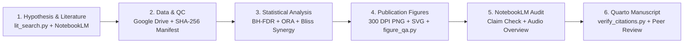
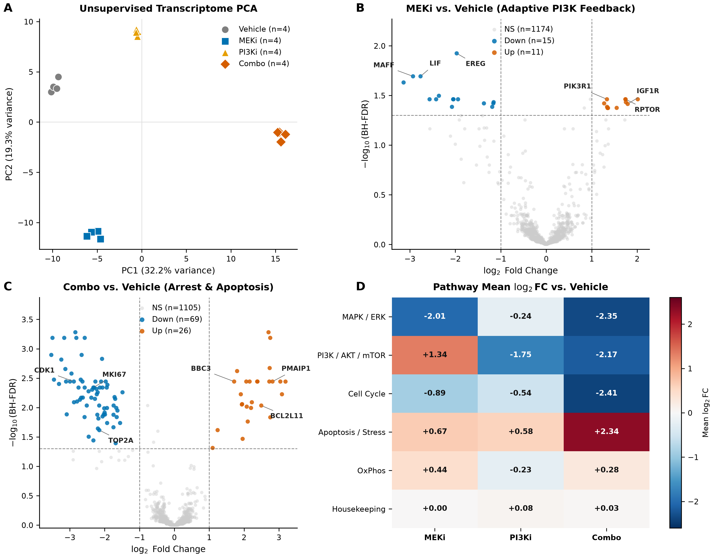
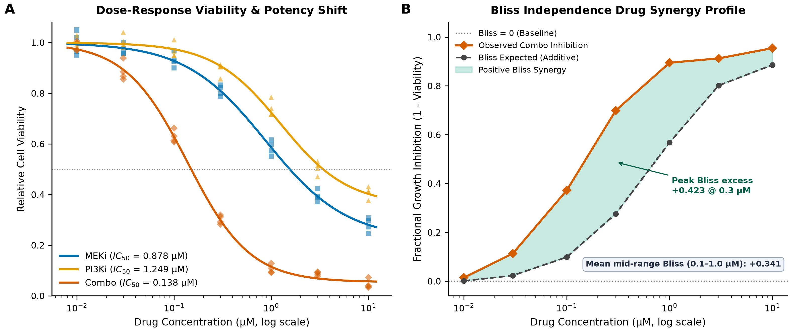

# Use Agentic AI in Science 🧬🤖

An **open-source teaching repository & reference workspace** demonstrating how to conduct rigorous, reproducible scientific research with **agentic AI**—from pre-registered hypothesis generation and literature synthesis to statistical analysis, publication-grade figure design, NotebookLM cross-checking, Google Drive data management, and Quarto manuscript writing.

Designed to work seamlessly with any AI coding agent (**Antigravity**, **Claude Code**, **Cursor**, **Gemini CLI**, **Codex**) and ready to present in a **15–20 minute lab meeting demo** (see [`docs/lab-meeting-demo.md`](./docs/lab-meeting-demo.md)).

---

## Why This Architecture?

Most scientists start using AI by pasting text into a chat box—which quickly leads to hallucinated citations, untracked data transformations, and irreproducible plots. This repository demonstrates an **agent-native scientific workspace** built on four principles:

1. **Scientific Constitution ([`AGENTS.md`](./AGENTS.md))**: Explicit guardrails prohibiting fabricated citations, silent p-hacking, or unverified numbers, with mandatory **Human-in-the-Loop (HITL)** sign-off gates.
2. **Modular Research Skills ([`.agents/skills/`](./.agents/skills/))**: Reusable playbooks for hypothesis generation, statistical analysis, publication figure design, Quarto manuscript writing, and research operations.
3. **Deterministic Helper Tools ([`tools/`](./tools/))**: Standalone Python CLIs that ground the agent in real APIs (Europe PMC, CrossRef), enforce figure QA (≥ 300 DPI + vector SVG), package sources for **NotebookLM**, and sync unpublished files with **Google Drive**.
4. **Clean Git vs. Google Drive Separation**:
   - **Published in Git**: Code, agent skills, Quarto manuscript source, verified BibTeX, documentation, and SHA-256 data manifests.
   - **Stored in Google Drive (Unpublished)**: Raw/processed datasets, primary literature PDFs, NotebookLM source packets, intermediate analysis results, and saved collaborator manuscript drafts.



---

## Worked Example: Dual MAPK/PI3K Inhibition in Melanoma ([`example-study/`](./example-study/))

To make this immediately teachable in a lab meeting, [`example-study/`](./example-study/) walks through a complete, deterministic bioinformatics study (*16 RNA-seq samples across 4 treatment arms + 7-point dose-response viability curves*):

- **H1 (Adaptive Feedback)**: Single-agent `MEKi` suppresses `MAPK_ERK_Signaling` (mean $\log_2\text{FC} = -2.01$, $\text{FDR} = 1.64 \times 10^{-16}$) while triggering compensatory `PI3K_AKT_mTOR_Signaling` upregulation (mean $\log_2\text{FC} = +1.34$, $\text{FDR} = 1.25 \times 10^{-19}$).
- **H2 (Dual-Blockade Synergy)**: Combined `MEKi + PI3Ki` (`Combo`) extinguishes adaptive PI3K signaling, drives coordinated `Cell_Cycle_Proliferation` arrest (mean $\log_2\text{FC} = -2.41$) and `Apoptosis_Stress_Response` induction (mean $\log_2\text{FC} = +2.34$), shifts $IC_{50}$ by `6.4x` (`0.138 µM` vs. `0.878 µM`), and achieves `+0.423` peak Bliss excess synergy.

| Figure 1: Transcriptomic Landscape | Figure 2: Dose-Response & Bliss Synergy |
| :---: | :---: |
|  |  |

---

## Quickstart (Reproduce Everything in < 30 Seconds)

Choose your preferred scientific environment manager (**`uv`**, **`conda`/`mamba`**, or **`pixi`**):

- **Option A — `uv` (Recommended, fastest Python lockfile):**
  ```bash
  uv sync --extra dev
  uv run pytest -v
  ```
- **Option B — `conda` / `mamba` (familiar in bioinformatics/HPC):**
  ```bash
  conda env create -f environment.yml   # or: mamba env create -f environment.yml
  conda activate agentic-science
  pytest -v
  ```
- **Option C — `pixi` (fast conda-forge + PyPI lockfile):**
  ```bash
  pixi install
  pixi run reproduce
  pixi run test
  ```

### Run the Full Pipeline (with `uv run`, `pixi run`, or inside `conda activate agentic-science`)

```bash
# 1. Generate deterministic benchmark dataset + SHA-256 manifest
uv run python example-study/02_data/generate_dataset.py

# 3. Run QC, PCA, differential expression (BH-FDR), pathway ORA, Hill IC50 & Bliss synergy
uv run python example-study/03_analysis/run_analysis.py

# 4. Generate publication-grade figures (300 DPI PNG + vector SVG) and run automated QA
uv run python example-study/04_figures/make_figures.py
uv run python tools/figure_qa.py example-study/04_figures/output

# 5. Build a NotebookLM source packet (ready to upload or sync to Google Drive)
uv run python tools/notebooklm_prep.py \
  --study-dir example-study \
  --out-dir example-study/05_notebooklm/packet

# 6. Verify all manuscript citations against references.bib & CrossRef API
uv run python tools/verify_citations.py \
  --bib example-study/06_manuscript/references.bib \
  --qmd example-study/06_manuscript/manuscript.qmd

# 7. Run automated test suite
uv run pytest
```

To render the Quarto manuscript (requires [Quarto](https://quarto.org/)):
```bash
quarto render example-study/06_manuscript/manuscript.qmd --to html
quarto render example-study/06_manuscript/manuscript.qmd --to docx
```

---

## Repository Structure

```text
use-agentic-ai-in-science/
├── AGENTS.md                         # Scientific guardrails & HITL checkpoints for any AI agent
├── CLAUDE.md                         # Companion entrypoint for Claude Code
├── .agents/skills/                   # Modular research skills (hypothesis, analysis, figures, writing, ops)
├── docs/
│   ├── lab-meeting-demo.md           # 15-20 min presenter playbook & live prompts for lab meetings
│   ├── workflow.md                   # 6-stage agentic research lifecycle
│   ├── google-drive-integration.md   # Keeping unpublished data, results & drafts in Google Drive
│   ├── notebooklm-workflow.md        # Literature synthesis, claim auditing & Audio Overviews
│   └── helper-tools-guide.md         # CLI reference for all 5 scientific helper tools
├── tools/
│   ├── lit_search.py                 # Live Europe PMC literature search -> JSON / Markdown / BibTeX
│   ├── verify_citations.py           # CrossRef DOI & Quarto @citekey anti-hallucination auditor
│   ├── notebooklm_prep.py            # Compile clean source packets & prompt banks for NotebookLM
│   ├── gdrive_sync.py                # Google Drive sync (gdrive CLI / rclone) + SHA-256 manifests
│   └── figure_qa.py                  # Automated DPI, dimension & vector-pair figure QA
├── example-study/                    # Complete runnable bioinformatics worked example
└── tests/test_pipeline.py            # Automated pytest verification suite
```

---

## Guides & Presentations

- **Presenting to your lab?** Start with [`docs/lab-meeting-demo.md`](./docs/lab-meeting-demo.md).
- **Setting up Google Drive for unpublished data & drafts?** See [`docs/google-drive-integration.md`](./docs/google-drive-integration.md).
- **Integrating NotebookLM?** See [`docs/notebooklm-workflow.md`](./docs/notebooklm-workflow.md).
- **Exploring the helper CLIs?** See [`docs/helper-tools-guide.md`](./docs/helper-tools-guide.md).
