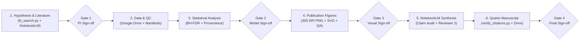

# End-to-End Agentic Scientific Research Workflow

This repository models scientific research as a **6-stage closed-loop pipeline** with explicit **Human-in-the-Loop (HITL) decision gates**. AI agents accelerate literature retrieval, coding, plotting, and drafting, while the researcher retains full authority over hypotheses, statistical assumptions, and scientific claims.

## Stage-by-Stage Responsibilities

| Stage | Agent Role | Researcher (Human) Role | Key Artifacts |
|---|---|---|---|
| **1. Hypothesis** | Retrieve peer-reviewed papers via Europe PMC; structure hypotheses & falsification criteria | Define biological question; approve pre-registered hypotheses | `01_hypothesis/hypothesis_log.md`, `literature_synthesis.md` |
| **2. Data & Provenance** | Pull datasets from Google Drive; compute SHA-256 checksums; run QC checks | Verify experimental metadata, batch structure, and sample inclusion | `02_data/raw_manifest.json`, Google Drive archive |
| **3. Statistical Analysis** | Write deterministic analysis scripts; run multiple-testing correction & sensitivity checks | Validate statistical model assumptions and negative controls | `03_analysis/run_analysis.py`, `analysis_summary.md`, `provenance.json` |
| **4. Figure Design** | Generate colorblind-safe multi-panel figures (PNG + SVG); run `figure_qa.py` | Critique visual clarity, biological narrative, and figure legends | `04_figures/make_figures.py`, `output/*.png`, `output/*.svg` |
| **5. NotebookLM Audit** | Package study docs via `notebooklm_prep.py` for source-grounded cross-checking | Review literature contradictions, audio overviews, and claim audits | `05_notebooklm/packet/` (synced to Google Drive) |
| **6. Manuscript Writing** | Draft Quarto `.qmd` IMRaD sections; verify every DOI via `verify_citations.py`; simulate peer review | Edit scientific framing, own all claims, approve co-author Drive export | `06_manuscript/manuscript.qmd`, `references.bib`, `peer_review_checklist.md` |
